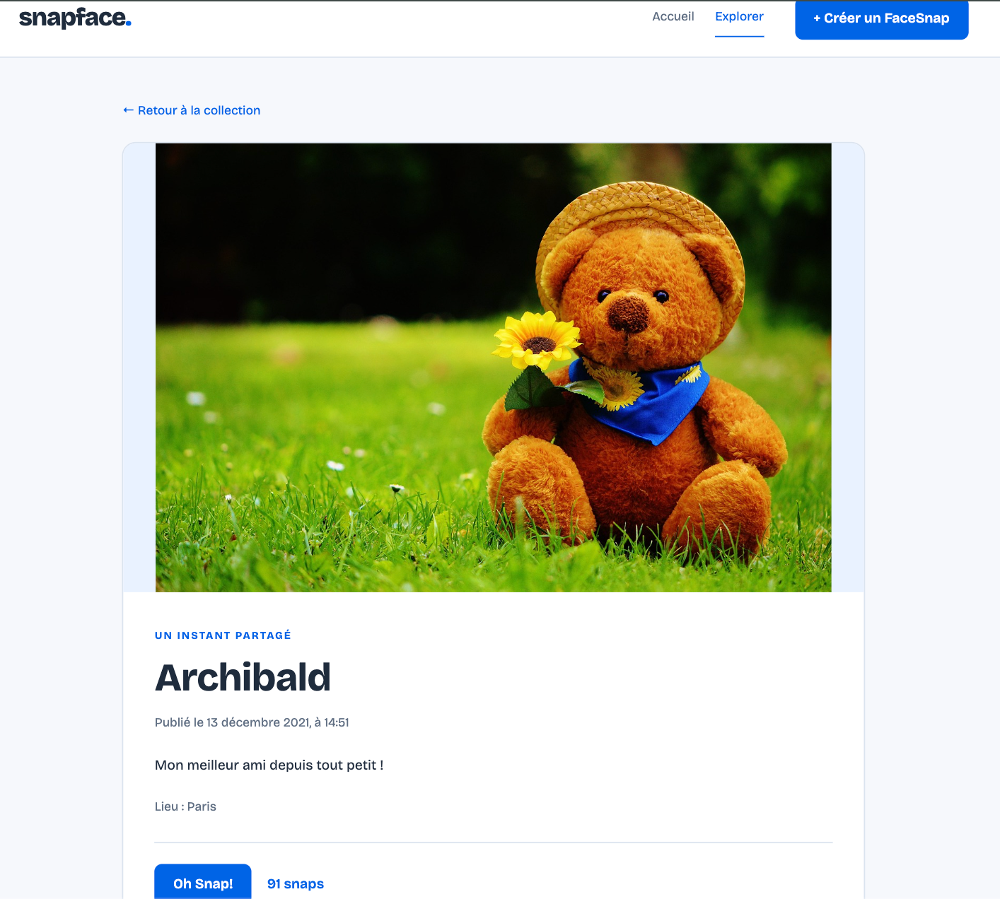

# Snapface

Snapface est une application web de partage de photographies développée avec **Angular 21**. Elle permet de parcourir une collection de photos, de consulter leurs détails, de réagir aux publications et d'en ajouter de nouvelles.

Ce projet a été réalisé dans le cadre des formations Angular d'**OpenClassrooms**, puis adapté à une architecture moderne fondée sur les composants *standalone*.

## Fonctionnalités

- Consultation d'une galerie de photographies et de leurs fiches détaillées.
- Ajout ou retrait d'un « snap » sur une publication, avec mise à jour du compteur.
- Création d'une publication à partir d'un formulaire validé, avec aperçu avant enregistrement.
- Navigation entre les pages sans rechargement complet de l'application.
- Lecture et mise à jour des données via une API HTTP locale.

## Aperçu de l'application

### Page d'accueil


### Galerie de FaceSnaps


### Détail d'une publication



## Technologies utilisées

**Frontend :** Angular 21, TypeScript, Angular Router, HttpClient, RxJS et formulaires Angular (*Reactive Forms* et *Template-driven Forms*).

**Backend de démonstration :** JSON Server 0.17, qui expose une API REST locale à partir du fichier `backend/db.json`.

## Architecture

Le frontend est organisé par fonctionnalité et utilise des composants *standalone* :

```text
snapface/
├── backend/
│   ├── db.json
│   ├── package.json
│   └── package-lock.json
├── src/
│   └── app/
│       ├── app.ts
│       ├── app.config.ts
│       ├── app.routes.ts
│       ├── auth/                # Guard, service et intercepteur
│       ├── layout/header/       # En-tête de l'application
│       ├── landing-page/        # Page d'accueil
│       └── face-snaps/          # Galerie, détail, création et service HTTP
├── angular.json
└── package.json
```

La configuration générale est centralisée dans `app.config.ts`. Les services utilisent l'injection de dépendances d'Angular. Le routage repose sur `loadComponent` et `loadChildren` pour charger les fonctionnalités à la demande (lazy loading).

## Installation et démarrage

### Prérequis

- Node.js et npm, dans des versions compatibles avec Angular 21.
- Les dossiers `src/` et `backend/` présents dans le dépôt.

### 1. Démarrer le backend

Depuis la racine du projet, ouvrir un premier terminal :

```bash
cd backend
npm install
npm start
```

L'API est disponible à l'adresse **http://localhost:3000/facesnaps**.

### 2. Démarrer le frontend

Ouvrir un second terminal à la racine du projet :

```bash
npm install
npm start
```

L'application est accessible à l'adresse **http://localhost:4200**.

Le frontend utilise `http://localhost:3000` pour ses requêtes HTTP : les deux serveurs doivent donc être démarrés pour utiliser les fonctionnalités liées aux données.

### Compilation

Pour générer une version de production du frontend :

```bash
npm run build
```

Les fichiers compilés sont placés dans le dossier `dist/`.

## Périmètre du projet

- Le backend repose sur **JSON Server**, qui conserve les données dans un fichier JSON local. Il ne constitue pas une API métier destinée à la production.
- L'authentification est **simulée** : le guard et l'intercepteur illustrent des mécanismes Angular, mais le token utilisé est fictif et aucun contrôle d'accès sécurisé n'est assuré par le backend.
- Le formulaire de newsletter de la page d'accueil est une démonstration : il n'enregistre pas d'inscription réelle.

## Crédits

Projet réalisé à partir des cours **« Débutez avec Angular »** et **« Complétez vos connaissances sur Angular »** d'[OpenClassrooms](https://openclassrooms.com/), avec adaptation à Angular 21 et personnalisation de l'application.
